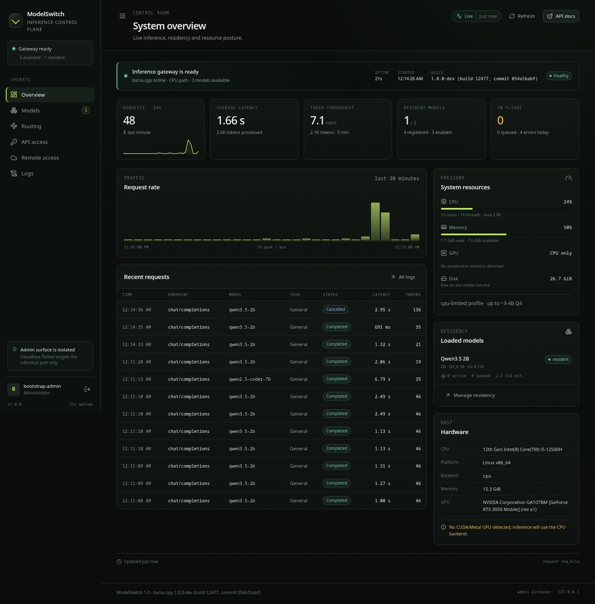

# ModelSwitch

**A hardware-adaptive local LLM gateway for llama.cpp.** One OpenAI-compatible
endpoint, many GGUF models, and a router that chooses the best *feasible* model
for each request instead of always choosing the largest one.

ModelSwitch is designed for ordinary consumer machines: a 4 GB laptop GPU and a
24 GB workstation use the same software, but not the same models, context sizes,
or residency policy. Inference always runs locally. Cloudflare Tunnel is optional
transport, never compute.



## What it does

- **OpenAI-compatible API** at `/v1` — chat completions, legacy completions,
  models, streaming SSE, usage, normalized errors, and model aliases.
- **Intelligent routing** — a sub-millisecond heuristic classifier, an optional
  lightweight local decision model for ambiguous prompts, and a deterministic
  policy that scores task fit, context, RAM/VRAM, measured latency, queue depth,
  residency, and operator priority.
- **Memory-aware model lifecycle** — does not load every model. Estimates RAM and
  VRAM before loading, evicts idle models, refuses to evict active ones, coalesces
  duplicate loads, and supports on-demand/keep-loaded/idle-timeout policies.
- **Multiple local GGUF models** with automatic metadata extraction, aliases,
  capability metadata, quantization/context awareness, and hardware recommendations.
- **Concurrent and fair** — per-model parallel slots, bounded queues, priority
  classes, per-key fair ordering, cancellation, timeouts, and graceful shutdown.
- **Secure by construction** — hashed API keys, admin/inference roles, scoped
  permissions, sliding-window rate limits, request-size limits, path confinement,
  and a separate loopback-only admin listener.
- **Management dashboard** — system health, models, routing explanations, API-key
  management, tunnel status, request history, and backend events. Real data only.
- **Optional remote access** — quick or named Cloudflare Tunnel. The admin
  dashboard is never proxied.
- **Observability** — structured logs, request IDs, Prometheus metrics, health,
  readiness, routing traces, and backend event history.

## Quick start

### Linux / macOS

```bash
./scripts/start.sh
```

The first run creates a Python virtualenv, installs dependencies, builds
`llama.cpp` if needed, builds the dashboard if needed, initializes the database,
prints the initial **admin** and **inference** API keys **once**, and starts both
listeners.

- Inference API: `http://127.0.0.1:8000/v1`
- Dashboard: `http://127.0.0.1:8001/admin`
- Health: `http://127.0.0.1:8000/healthz`

### Windows

```powershell
.\scripts\start.ps1
```

Requires Python 3.11+, CMake, and a C++ toolchain (Visual Studio Build Tools for a
native llama.cpp build). See [docs/OPERATIONS.md](docs/OPERATIONS.md).

### Docker (optional)

```bash
docker compose build
docker compose run --rm modelswitch init   # prints keys once; store them
docker compose up -d
```

The compose file publishes both ports on host loopback only. Put GGUF files in
`./models`; runtime state lives in `./data`.

### Register models

Use the dashboard **Models → Scan & import**, or the CLI:

```bash
.venv/bin/python -m app models add \
  --path /home/you/models/Qwen2.5-Coder-7B-Instruct-Q4_K_M.gguf \
  --name "Qwen2.5 Coder 7B" \
  --context 8192 --priority 80 --concurrency 2
```

Or scan configured roots:

```bash
.venv/bin/python -m app models scan
```

### Connect a client

```python
from openai import OpenAI

client = OpenAI(
    base_url="http://127.0.0.1:8000/v1",
    api_key="<your-inference-key>",
)

response = client.chat.completions.create(
    model="auto",  # or fast / coding / reasoning / a model id / an alias
    messages=[{"role": "user", "content": "Explain Kubernetes networking"}],
)
print(response.choices[0].message.content)
```

```bash
curl http://127.0.0.1:8000/v1/chat/completions \
  -H "Authorization: Bearer $MODELSWITCH_API_KEY" \
  -H "Content-Type: application/json" \
  -d '{"model":"auto","messages":[{"role":"user","content":"Hello"}]}'
```

## Routing aliases

| Alias | Meaning |
|---|---|
| `auto` | Intelligent task-aware routing. The default. |
| `default` | Alias for `auto`. |
| `fast` | Lowest expected time-to-first-token / fastest feasible model. |
| `coding` | Best feasible coding/debugging specialist, with optional general fallback. |
| `reasoning` | Best feasible reasoning/math model. |
| model id | Explicit model; bypasses auto selection but still obeys auth and resources. |
| model alias | User-defined explicit alias (for example `workhorse`). |

Every response includes routing metadata for authenticated callers:

```json
{
  "modelswitch": {
    "routing": {
      "task": "code_generation",
      "selected_model": "qwen2.5-coder-7b",
      "explanation": "Selected … because it matches the task capability …",
      "alternatives": [{"model": "qwen3.5-2b", "score": 45.1}],
      "routing_ms": 0.9,
      "fallback_used": false
    },
    "queue_ms": 0.0,
    "load_ms": 0.0
  }
}
```

## Architecture

```
OpenAI client / coding agent / Continue / Open WebUI
                    │
                    ▼
        Public listener :8000  (loopback by default)
        auth → body limit → request id → rate limit
                    │
                    ▼
        classifier → policy → fallback candidates
                    │
                    ▼
     memory-aware model lifecycle manager
     ├── llama.cpp server (model A) :ephemeral loopback port
     ├── llama.cpp server (model B) :ephemeral loopback port
     └── …
                    │
                    ▼
        normalized response / SSE stream

Admin listener :8001 (loopback only) → React dashboard + control API
Cloudflare Tunnel ───────────────────► public listener only
```

See [docs/ARCHITECTURE.md](docs/ARCHITECTURE.md) for the full design, routing
weights, memory estimation, and failure semantics.

## Security model

- Plaintext API keys are shown once. The database stores a deterministic lookup
  hash plus salted scrypt hash. Revocation is checked on every request.
- Admin endpoints and the dashboard are on a **separate listener**. The Cloudflare
  connector targets only the public inference port; `/admin` through the tunnel
  returns 404.
- Model paths must resolve inside configured roots unless an administrator
  explicitly enables external paths. Only admin keys can register or inspect
  local model files.
- The gateway never forwards the client `Authorization` header to llama.cpp.
  Backends listen on loopback only.
- Request bodies are capped (default 2 MiB), keys have RPM/TPM budgets, and
  repeated authentication failures are throttled per client IP.
- Secrets are redacted from logs. The tunnel token is passed via environment, not
  argv.

See [SECURITY_AUDIT.md](SECURITY_AUDIT.md) for the audit and test evidence.

## Hardware behavior

ModelSwitch probes CPU, physical cores, RAM, disk, CUDA GPUs, Apple Metal, and
fallback GPUs. It plans GPU layers per model and reserves memory for display and
runtime overhead. On a CPU-only machine it keeps one small model resident and
evicts it when idle. On a GPU machine it can offload full or partial layers. A
model that cannot fit is not selected, even if it has the best capability score.

The default resident budget is deliberately small (`MS_MAX_RESIDENT_MODELS=2`);
tune it to your hardware. See [docs/OPERATIONS.md](docs/OPERATIONS.md).

## Documentation

- [Architecture](docs/ARCHITECTURE.md)
- [API reference](docs/API.md)
- [Operations and installation](docs/OPERATIONS.md)
- [Troubleshooting](docs/TROUBLESHOOTING.md)
- [Cloudflare Tunnel guide](docs/CLOUDFLARE.md)
- [Client compatibility](docs/COMPATIBILITY.md)
- [Security audit](SECURITY_AUDIT.md)
- [Benchmark report](reports/BENCHMARKS.md) (generated from measurements)
- [Release readiness](RELEASE_READINESS.md)
- [Project status](PROJECT_STATUS.md)

## Tests

```bash
.venv/bin/pytest -q                         # all tests
.venv/bin/pytest -q -m "not integration"    # fast unit/API/security tests
.venv/bin/pytest -q -m integration          # real llama.cpp inference
```

Measured benchmarks:

```bash
MS_ADMIN_KEY=... MS_INFERENCE_KEY=... .venv/bin/python scripts/benchmark.py \
  --models qwen3.5-2b,smollm3-3b
```

## Verification honesty

The repository contains a working Linux/CPU-verified implementation with real
llama.cpp inference, real Cloudflare quick-tunnel verification, and real
OpenAI-SDK integration tests. CUDA execution, named Cloudflare Tunnels (which
require an account/domain), and Windows/macOS native runs are implemented but were
not verifiable on the build host; they are marked as externally blocked in
[RELEASE_READINESS.md](RELEASE_READINESS.md) rather than claimed as passed.

## License

MIT. See [LICENSE](LICENSE).
